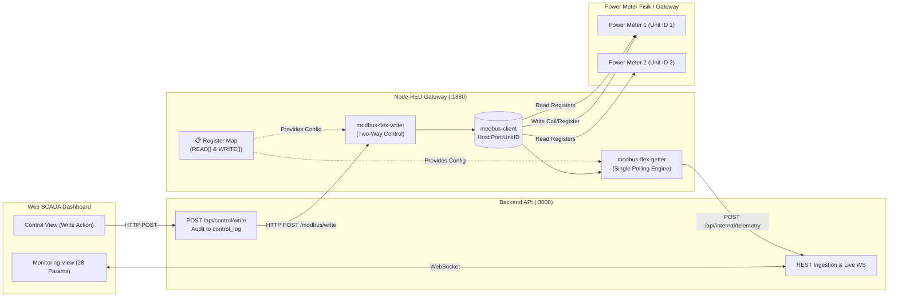

# Panduan Konfigurasi Modbus TCP (Read & Write Dua Arah)

Sistem Energy SCADA ini menggunakan **Node-RED dengan palette resmi `node-red-contrib-modbus`** untuk membaca (*polling telemetry*) dan menulis (*control/setpoint write*) parameter listrik tiga fasa dari Power Meter industri melalui protokol **Modbus TCP**.

Seluruh konfigurasi register disederhanakan ke dalam **satu tabel terpusat (Register Map)** di Node-RED tanpa perlu membuat banyak timer polling manual.

---

## 1. Arsitektur Komunikasi Modbus TCP



### Keunggulan Arsitektur:
1. **Satu Koneksi TCP Stabil**: Menghindari bentrok soket TCP antara proses read dan write karena diatur oleh antrian internal `modbus-client`.
2. **Dynamic Poller (Flex Getter)**: Polling terjadwal hanya memanggil register yang alamatnya sudah diset (`address !== null`).
3. **Bind-Mounted Storage**: File flow tersimpan langsung di folder `./nodered/data/flows.json` di host, sehingga perubahan di editor Node-RED langsung tersimpan ke repository.

---

## 2. Cara Mengatur & Menambah Register

Buka Node-RED editor di browser: **[http://localhost:1880](http://localhost:1880)**.
Pilih tab **`0. Register Map`**, lalu klik ganda pada function node **`📋 Register Map (READ & WRITE)`**.

### A. Menentukan Register Pembacaan (READ)

Di dalam function node, terdapat array `READ`:

```javascript
const READ = [
  // --- KWH BESAR (Meter 1, Unit ID 1) ---
  { meter: 'kwh-besar', unitId: 1, key: 'voltageR', fc: 3, address: null, type: 'float32', wordSwap: false, scale: 1.0 },
  { meter: 'kwh-besar', unitId: 1, key: 'voltageS', fc: 3, address: null, type: 'float32', wordSwap: false, scale: 1.0 },
  { meter: 'kwh-besar', unitId: 1, key: 'voltageT', fc: 3, address: null, type: 'float32', wordSwap: false, scale: 1.0 },
  ...
];
```

#### Penjelasan Properti:
| Properti | Tipe Data | Keterangan | Contoh |
|---|---|---|---|
| `meter` | `string` | Target meter: `'kwh-besar'` atau `'kwh-kecil'` | `'kwh-besar'` |
| `unitId` | `number` | Slave ID / Unit ID perangkat meter | `1` |
| `key` | `string` | Nama parameter kanonik (14 parameter dashboard) | `'voltageR'`, `'currentR'`, `'wattR'`, dll. |
| `fc` | `number` | Function Code Modbus:<br/>`3`: Read Holding Registers<br/>`4`: Read Input Registers | `3` atau `4` |
| `address` | `number \| null` | Alamat register awal (0-based atau 1-based sesuai manual meter). **Jika masih `null`, meter tidak akan dibaca (mencegah data palsu).** | `3000` |
| `type` | `string` | Format decoding data register:<br/>`'float32'`: 2 words IEEE-754 32-bit float<br/>`'uint32'`: 2 words unsigned 32-bit integer<br/>`'int32'`: 2 words signed 32-bit integer<br/>`'uint16'`: 1 word unsigned 16-bit integer<br/>`'int16'`: 1 word signed 16-bit integer | `'float32'` |
| `wordSwap` | `boolean` | `true` jika meter menggunakan urutan word terbalik (CDAB / little-endian word). `false` untuk standar big-endian (ABCD). | `false` |
| `scale` | `number` | Faktor pengali nilai ukur engineering. Contoh: jika meter mengirim nilai tegangan 2205 untuk 220.5 V, isi `scale: 0.1`. | `1.0` |

#### Langkah Mengaktifkan Meter:
1. Buka buku manual Power Meter Anda dan cari tabel **Modbus Register Address List**.
2. Masukkan nomor register ke properti `address` untuk masing-masing parameter.
3. Klik tombol **Done**, lalu klik **Deploy** di pojok kanan atas editor Node-RED.
4. Di file `.env`, ubah mode ke `ENERGY_SOURCE_MODE=device`.
5. Restart layanan:
   ```powershell
   docker compose restart nodered backend
   ```

---

### B. Menentukan Titik Kontrol Tulis Dua Arah (WRITE)

Di function node yang sama, terdapat array `WRITE`:

```javascript
const WRITE = [
  // Channel 1: Living Room Lamp (Coil 10)
  { 
    tag: 'lamp-1', 
    label: 'Living Room Lamp', 
    meterId: 'kwh-besar',
    unitId: 1, 
    fc: 5, 
    address: 10, 
    type: 'bool', 
    description: 'Living Room pendant lamp lighting control' 
  },

  // Channel 2: Kitchen Lamp (Coil 11)
  { 
    tag: 'lamp-2', 
    label: 'Kitchen Lamp', 
    meterId: 'kwh-besar',
    unitId: 1, 
    fc: 5, 
    address: 11, 
    type: 'bool', 
    description: 'Kitchen pendant lamp lighting control' 
  }
];
```

#### Cara Kerja Titik Kontrol:
- Begitu Anda menambahkan baris di array `WRITE` dan menekan **Deploy**, titik kontrol tersebut **otomatis muncul di halaman Control Dashboard web** (`http://localhost:8080/control`).
- Jika bertipe `'bool'`, antarmuka menampilkan tombol **Switch ON/OFF**.
- Jika bertipe `'float32'` / integer, antarmuka menampilkan **input angka + batasan min/max + tombol Tulis**.
- Setiap aksi tulis dari dashboard akan diverifikasi oleh backend, dieksekusi via `modbus-flex-writer`, dan otomatis dicatat ke tabel audit `control_log` di PostgreSQL.

---

## 3. Konfigurasi Alamat IP & Port Gateway

Jika Power Meter fisik atau Modbus TCP Gateway Anda memiliki alamat IP jaringan tertentu:
1. Buka file `.env`:
   ```env
   MODBUS_HOST=192.168.1.150
   MODBUS_PORT=502
   POLL_INTERVAL_MS=1000
   ```
2. Atau di editor Node-RED:
   - Buka panel kanan -> tab **Configuration Nodes**.
   - Klik ganda pada node **`Modbus TCP Gateway`**.
   - Ubah kolom **Host** dan **Port** sesuai IP perangkat meter Anda.
   - Klik **Update** dan **Deploy**.

---

## 4. Pengujian & Validasi Komunikasi

### A. Memeriksa Status Indikator di Node-RED
- Indikator **Kuning** pada node poller: Register map belum diset (alamat masih `null`).
- Indikator **Biru** (`Polling N registers...`): Poller aktif mengirim permintaan baca.
- Indikator **Hijau** (`kwh-besar read ok`): Data register berhasil dibaca dan didekode.
- Indikator **Merah** (`Modbus error: ...`): Masalah koneksi jaringan atau Slave ID tidak merespons.

### B. Memeriksa Telemetry di Dashboard
Buka [http://localhost:8080](http://localhost:8080).
- Di pojok kiri bawah sidebar, status sumber data akan menampilkan **Modbus TCP** dengan indikator **Live**.
- Panel **KWH BESAR** dan **KWH KECIL** menampilkan nilai real-time dengan status badge **Online**.
- Halaman **Control** menampilkan daftar saklar/input titik tulis yang siap dioperasikan.
